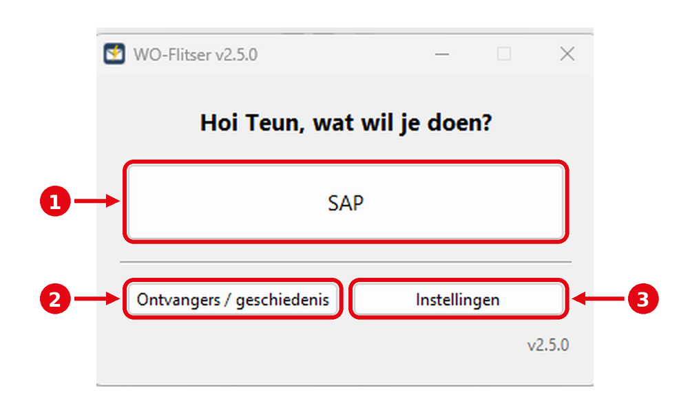
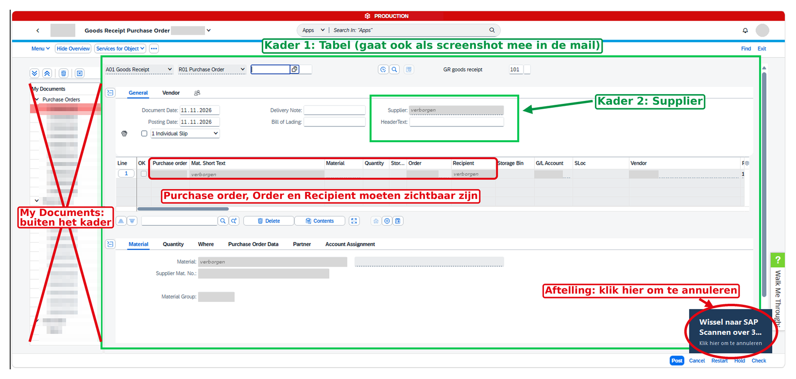
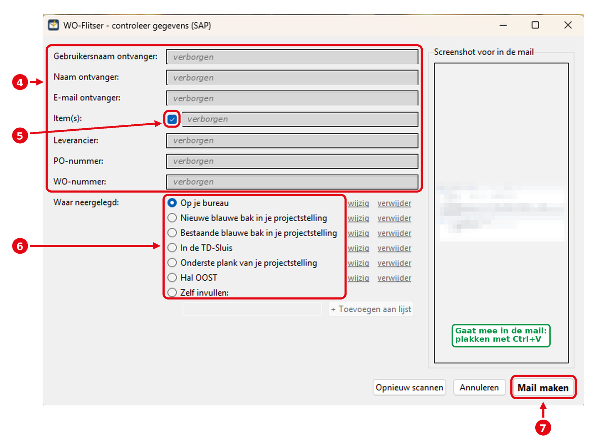
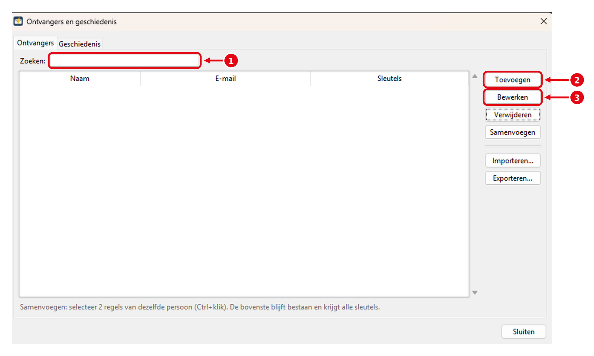
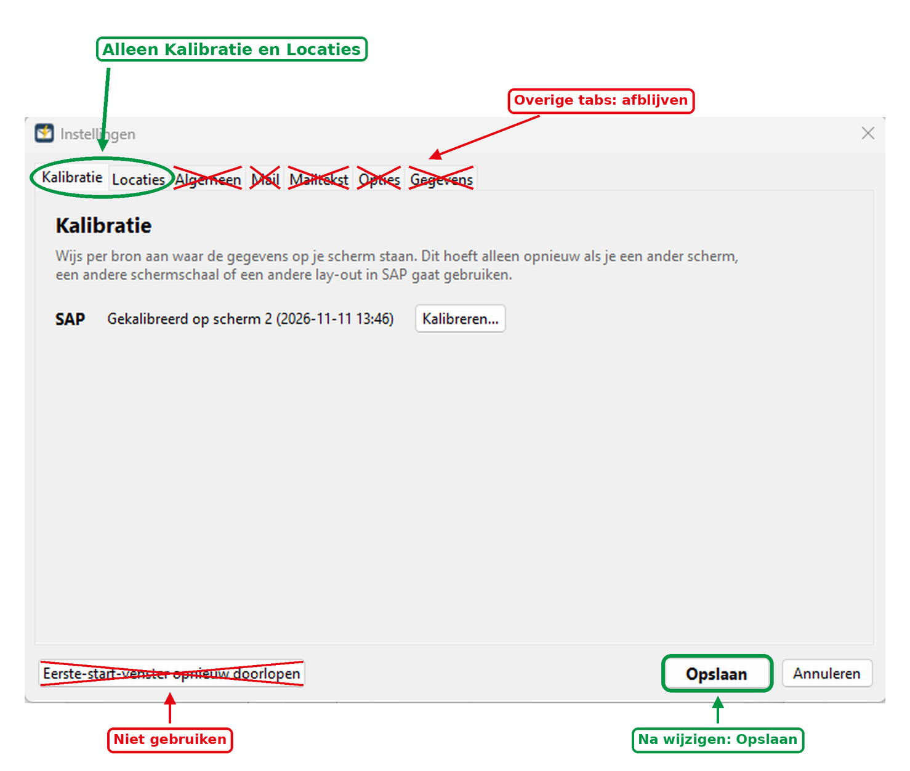
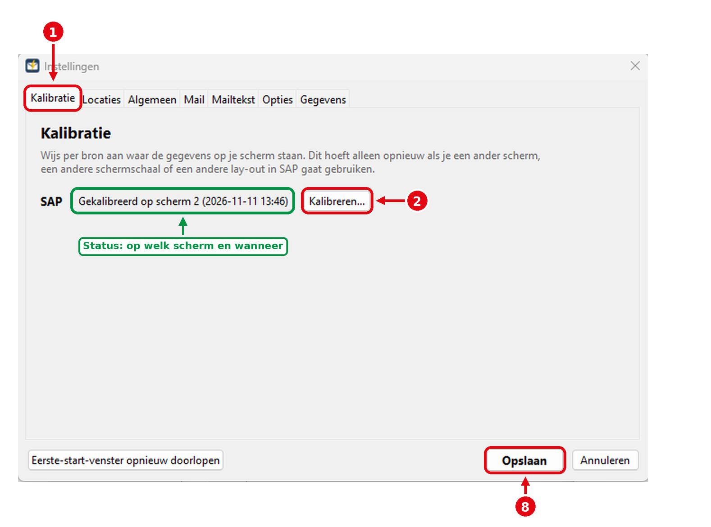
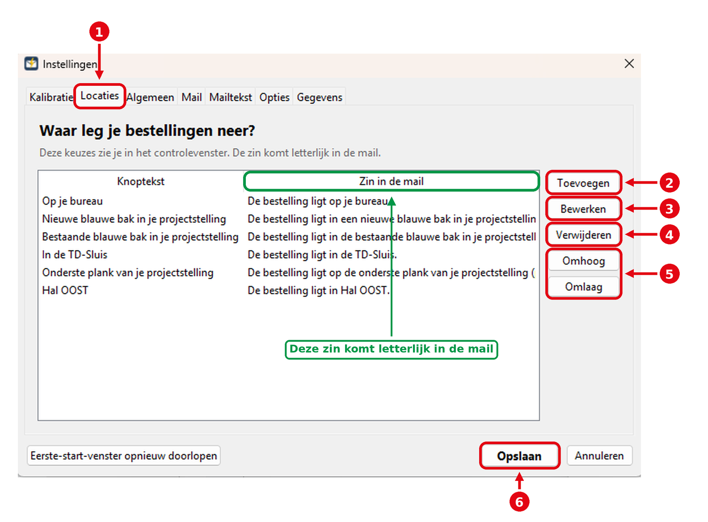
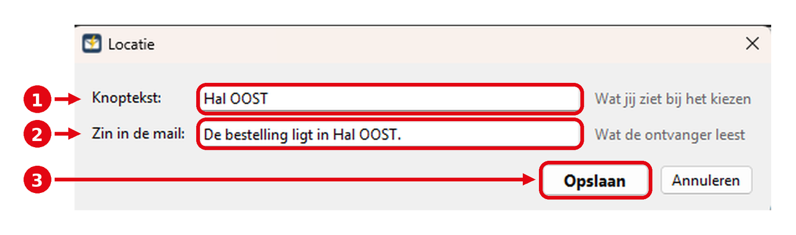

# Werkinstructie WO-Flitser v2.5.0

[Terug naar de downloadpagina](README.md)

## Doel en spelregels

De WO-Flitser leest na een goederenontvangst het SAP-scherm uit en zet een conceptmail klaar voor de ontvanger van de bestelling. De mail wordt nooit vanzelf verstuurd: je controleert en verstuurt hem altijd zelf.

| Onderdeel | Aanpassen? |
| --- | --- |
| Startscherm: SAP | Ja, dagelijks gebruik |
| Ontvangers / geschiedenis | Ja, zoeken, toevoegen en bewerken |
| Instellingen > Kalibratie | Ja |
| Instellingen > Locaties | Ja |
| Instellingen > Algemeen, Mail, Mailtekst, Opties, Gegevens | Nee, afblijven |
| Knop "Eerste-start-venster opnieuw doorlopen" | Nee, niet gebruiken |

Twijfel je of iets aangepast mag worden? Vraag het eerst aan Teun Scheuten.

## Startscherm

Dubbelklik op WO-Flitser.exe of op het icoon op je bureaublad. Het startscherm heeft drie knoppen (afbeelding 1):

1. **SAP**: bestelling uit SAP mailen.
2. **Ontvangers / geschiedenis**: lijst met ontvangers en eerder gemaakte mails.
3. **Instellingen**: alleen voor Kalibratie en Locaties.

*Afbeelding 1: startscherm. 1 SAP, 2 Ontvangers / geschiedenis, 3 Instellingen.*

## Bestelling mailen via SAP

De tool leest het SAP-scherm uit dat open staat; zorg dus eerst dat de juiste bestelling in beeld is.

1. Open de bestelling in SAP (A01 Goods Receipt, R01 Purchase Order), met Purchase order, Order en Recipient zichtbaar in de tabel.
2. Klik in het startscherm op **SAP**.
3. Wissel binnen de afteltijd naar het SAP-scherm. Rechtsonder staat de melding "Wissel naar SAP"; klik erop om te annuleren. De groene kaders laten zien welke delen gelezen worden (afbeelding 2).
4. Controleer de gegevens in het controlevenster (afbeelding 3). Rood betekent: het programma twijfelt, kijk dit extra goed na.
5. Meerdere items op 1 PO (deellevering)? Vink aan wat er nu geleverd is. De rest komt in de mail onder "Nog niet geleverd".
6. Kies bij **Waar neergelegd** waar de bestelling ligt.
7. Klik op **Mail maken**.
8. Plak de screenshot met Ctrl+V in de mail, voeg de gescande pakbon toe als bijlage, controleer de mail en verstuur hem.

*Afbeelding 2: SAP tijdens het scannen. De groene kaders zijn de gekalibreerde gebieden. Persoons- en bedrijfsgegevens zijn verborgen.*

*Afbeelding 3: controlevenster. Nummers komen overeen met stap 4 tot en met 7. Persoons- en bedrijfsgegevens zijn verborgen.*

Leest het programma niets of verkeerde gegevens, kalibreer dan opnieuw (zie Kalibratie).

## Ontvangers

Aan de **sleutels** herkent de tool wie de ontvanger is: de SAP-gebruikersnaam en de volledige naam. Ontbreekt de SAP-gebruikersnaam, dan vult de tool naam en e-mail niet zelf in. Nummers verwijzen naar afbeelding 4.

1. **Zoeken**: typ een deel van de naam.
2. **Toevoegen**: nieuwe ontvanger met naam, e-mail en sleutels.
3. **Bewerken**: selecteer een regel en pas aan, bijvoorbeeld een ontbrekende SAP-gebruikersnaam bij Sleutels.

Op het tabblad **Geschiedenis** zie je welke mails eerder zijn gemaakt.

*Afbeelding 4: ontvangers. 1 Zoeken, 2 Toevoegen, 3 Bewerken.*

## Instellingen: alleen Kalibratie en Locaties

In Instellingen pas je alleen de tabs **Kalibratie** en **Locaties** aan. De andere tabs zijn door Teun ingesteld en blijven zoals ze zijn (afbeelding 5).

| Tab | Wat staat erin | Aanpassen? |
| --- | --- | --- |
| Kalibratie | Waar SAP op je scherm staat | **Ja** |
| Locaties | Plekken waar je bestellingen neerlegt | **Ja** |
| Algemeen | Naam en ondertekening | Nee |
| Mail | Hoe de mail gemaakt wordt | Nee |
| Mailtekst | Onderwerp en tekst van de mail | Nee |
| Opties | Wachttijd om naar SAP te wisselen, sluiten na mail | Nee |
| Gegevens | Ontvangers, screenshots, OCR, logboek | Nee |

Klik na een wijziging altijd op **Opslaan**. **Annuleren** sluit zonder iets te bewaren. Gebruik **Eerste-start-venster opnieuw doorlopen** niet: daarmee loop je alle instellingen opnieuw door.

*Afbeelding 5: alleen Kalibratie en Locaties aanpassen; de doorgestreepte tabs en knop niet gebruiken.*

## Kalibratie

Kalibratie vertelt de tool waar de SAP-gegevens op je scherm staan. Opnieuw kalibreren is alleen nodig bij een ander scherm, een andere schermschaal (bijvoorbeeld 125% of 150%), een andere lay-out in SAP, of als de tool niets of verkeerde gegevens leest.

**Voorbereiding:** open een bestelling in SAP (A01 Goods Receipt), met Purchase order, Order en Recipient zichtbaar in de tabel en het tabblad General met het veld "Supplier:".

1. Ga naar Instellingen > **Kalibratie** (afbeelding 6). Achter SAP staat de status, bijvoorbeeld "Gekalibreerd op scherm 2" met datum, of "Nog niet gekalibreerd".
2. Klik op **Kalibreren...** en daarna op **OK**.
3. Wissel binnen de wachttijd naar het SAP-scherm. De tool maakt een foto van al je schermen.
4. Heb je meer schermen, klik dan op het scherm waar SAP op staat.
5. **Stap 1/2 Tabel** (groot kader in afbeelding 2): trek met de muis een rechthoek vanaf de balk "A01 Goods Receipt" tot en met de tabel met de bestelregel(s). Meer naar onderen mag. Laat de lijst **My Documents** links buiten het kader: daar staan andere PO-nummers in. Dit deel gaat ook als screenshot mee in de mail. Klik op **Volgende**.
6. **Stap 2/2 Supplier** (klein kader in afbeelding 2): trek een rechthoek over alleen het veld "Supplier:" met de naam van de leverancier. Klik op **Volgende**.
7. **Testscan**: controleer PO-nummer, WO-nummer, gebruikersnaam ontvanger, item(s) en leverancier. Klopt alles, klik op **Opslaan**. Klopt het niet, klik op **Opnieuw kalibreren**.
8. Klik onderin het venster Instellingen op **Opslaan**.

Een rechthoek trekken kan door te slepen, of door linksboven en daarna rechtsonder te klikken. Verkeerd getrokken? Klik op **Opnieuw**.

*Afbeelding 6: tab Kalibratie. Nummers komen overeen met de stappen hierboven.*

## Locaties

Locaties zijn de keuzes bij **Waar neergelegd**. De **Zin in de mail** komt letterlijk in de mail; de bovenste locatie is standaard gekozen.

**Aanpassen** (afbeelding 7 en 8):

1. Ga naar Instellingen > **Locaties**.
2. **Toevoegen**: nieuwe locatie. Vul in:
    - **Knoptekst**: wat jij ziet bij het kiezen, bijvoorbeeld "Hal OOST".
    - **Zin in de mail**: wat de ontvanger leest, als hele zin met punt, bijvoorbeeld "De bestelling ligt in Hal OOST."
    - Klik op **Opslaan** in het venster Locatie.
3. **Bewerken** (of dubbelklik op een regel): pas de tekst aan.
4. **Verwijderen**: selecteer een regel en klik op Verwijderen.
5. **Omhoog / Omlaag**: verandert de volgorde. Zet de plek die je het vaakst gebruikt bovenaan.
6. Klik onderin het venster Instellingen op **Opslaan**. Zonder Opslaan gaan de wijzigingen verloren.

*Afbeelding 7: tab Locaties. Nummers komen overeen met de stappen hierboven.*

*Afbeelding 8: venster Locatie. 1 Knoptekst, 2 Zin in de mail, 3 Opslaan.*

## Problemen oplossen

| Probleem | Oplossing |
| --- | --- |
| Tool leest niets of verkeerde gegevens | Kalibreer opnieuw via Instellingen > Kalibratie |
| Melding "Geen PO-nummer herkend" | Controleer of de juiste bestelling in SAP open staat en klik op Opnieuw; blijft het misgaan, kalibreer opnieuw |
| Naam en e-mail ontvanger blijven leeg | Vul ze zelf in; de tool onthoudt de ontvanger voor de volgende keer |
| Plek staat niet in de lijst | Kies Zelf invullen, of voeg de plek toe via Instellingen > Locaties |
| Mail opent niet, foutmelding of iets anders | Pas niets aan in de andere tabs en meld het bij Teun Scheuten |
